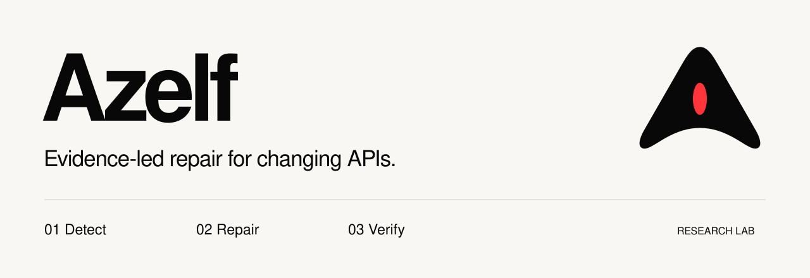
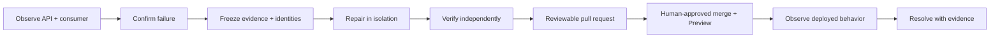
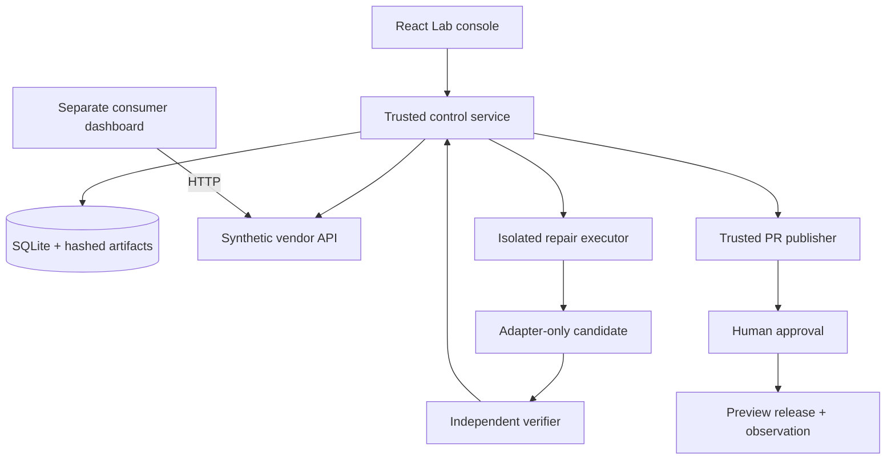

<p align="center">
  
</p>

<p align="center">
  <strong>A maintenance laboratory for detecting API breakage, proposing bounded code repairs, and proving that behavior is restored.</strong>
</p>

<p align="center">
  Research prototype · TypeScript + React · Isolated execution · Human-reviewed releases
</p>

<p align="center">
  <a href="#why-azelf">Why Azelf</a> ·
  <a href="#how-it-works">How it works</a> ·
  <a href="#try-it-locally">Try it locally</a> ·
  <a href="#architecture">Architecture</a> ·
  <a href="#documentation">Documentation</a>
</p>

## Why Azelf?

An upstream API can change while your application stays exactly the same. A renamed field breaks a filter. Pagination silently drops records. A changed unit makes a total look plausible but wrong.

Azelf explores a maintenance loop built around **preserving application behavior**. It records what failed, gives a repair executor a restricted workspace, and checks the resulting patch independently before preparing it for human review. A model's success claim is never the verification result.

The first implementation uses a synthetic permits API and a separate permit dashboard. This controlled setting makes failures reproducible and lets the Lab show the entire journey—from a healthy baseline to a proposed repair and observed recovery.

## How it works



| Stage | What Azelf does |
| --- | --- |
| **Detect** | Establishes a passing baseline, introduces a controlled upstream change, and confirms the failing capability with repeated observations. |
| **Repair** | Builds a source-bound evidence packet and restricts candidate edits to the allowed integration adapter inside a disposable container. |
| **Verify** | Applies the patch to a fresh source export and runs trusted checks outside the candidate's control, binding the result to source, fixture, and evaluator identities. |
| **Review** | Prepares a pull request with the verified diff and evidence. Publication, merge, and deployment have separate gates. |
| **Observe** | Checks the deployed consumer against the pinned vendor version across an actual observation window. A failed check keeps the incident open. |

**Restraint is part of the workflow.** An irrelevant additive field should need no patch. An outage should become an availability incident. An undocumented semantic change should request a decision rather than invite a guessed repair.

### A concrete example

1. The dashboard starts with three permits totaling **$375**; its status filters work.
2. The vendor renames a response field or introduces pagination without changing consumer code.
3. Azelf captures the failing behavior and the vendor contract, along with the exact source identities.
4. The executor proposes an adapter change. Independent checks validate records, totals, filters, and preserved behavior.
5. A human reviews the evidence and decides whether to merge and deploy. Hosted checks determine whether recovery was actually observed.

## What is implemented?

Azelf is a **single-operator research prototype**, with a working local Lab and a deliberately narrow integration surface.

| Area | Current scope |
| --- | --- |
| Landing page | Responsive React page, local SVG branding, illustrative maintenance timeline, and explicitly labeled preview forms. |
| Experiment Lab | Controlled vendor changes, baseline/broken/candidate views, persistent observations, diffs, and evidence inspection. |
| Repair execution | Recorded native runtime repair demonstrations with adapter-only container execution and separate credential handling. |
| Verification | Trusted HTTP/browser checks, source-bound proofs, isolation canaries, and retained failure artifacts. |
| Review and release | Guarded GitHub publication and synthetic Vercel Preview release tooling; human approval required for merge and deployment. |
| Research extensions | Development-workspace experiments in bounded traversal, versioned requirements, replay, challenges, and recipe transfer; not shipped in this branch. |

### Evidence and limits

The recorded native demonstrations include independently verified field-rename and combined repairs. The combined candidate passed **46/46 checks in a recorded GitHub Actions run** and reached an approved synthetic Preview deployment. The execution record does **not** establish completion of its final timed hosted observation. These are recorded development outcomes; historical local evidence is not bundled in a fresh clone.

Recipe-transfer research remains **partial**. Later exposed-development corrections do not retroactively turn failed primary experiments into unseen successes. Those research extensions remain in the development workspace and are not included in this branch.

This repository does not yet provide general repository onboarding, arbitrary API repair, multi-tenant operation, or autonomous production recovery. Landing-page signup and repository dialogs are previews; they do not connect services or register users. A fresh clone does not include the historical local database or ignored evidence archive.

## Try it locally

### Prerequisites

- **Node.js 24.18.0**, pinned in [.node-version](.node-version), and npm.
- **Git** for source identity and reproducible exports.
- **Docker** for isolated candidate execution and verification.
- **Playwright Chromium** for browser acceptance checks.

### Start the local Lab

```sh
npm ci
npx playwright install chromium
AZELF_EXECUTOR=fake npm run lab:dev
```

Open **[Azelf Lab](http://127.0.0.1:5173/lab)**. The landing page is available at **[the root URL](http://127.0.0.1:5173/)**. The control API binds to loopback on port `4100`; the console uses `5173`.

This command selects the fake executor for deterministic local exploration. Create an experiment, establish its healthy baseline, introduce a controlled vendor change, and inspect the resulting checks. Do not select native execution without its required authorization. Historical results require their original local evidence; they are not seeded by installing dependencies.

Stop with `Ctrl+C`, or use `npm run lab:stop` from another terminal. Local records live in `.azelf/`; preserve that directory if you need experiment history.

<details>
<summary><strong>Landing page only</strong></summary>

```sh
npm ci
npm run dev -- --host 127.0.0.1
```

This serves the frontend without starting the Lab control service. Early-access and repository dialogs remain preview interactions.

</details>

<details>
<summary><strong>Native execution and provider setup</strong></summary>

Live repair additionally requires the supported runtime runtime, existing authentication, current isolation canaries, and a valid explicitly approved invocation allowance. GitHub publication and Vercel Preview releases require their respective authenticated tools and exact source/evidence approval gates.

The historical five native invocation slots are consumed. Starting the Lab or copying [.env.example](.env.example) does not grant another invocation. The example file documents settings; it is not a credential bundle or a complete provider onboarding flow.

Read the [build guide](AZELF_FIRST_VERSION_BUILD_GUIDE.md) and [runtime boundary notes](docs/runtime-blocker.md) before performing provider actions. Status records are chronological; later dated evidence takes precedence over earlier pending states.

</details>

## Architecture



The repository is a modular application. Responsibility boundaries do not require a fleet of microservices or agents.

| Path | Responsibility |
| --- | --- |
| [`src/`](src/) | Landing page and Lab operator interface. |
| [`apps/vendor-api/`](apps/vendor-api/) | Versioned synthetic API fixtures and published contracts. |
| [`apps/consumer/`](apps/consumer/) | Independent permit dashboard and integration adapter. |
| [`services/control/`](services/control/) | Orchestration, observations, leases, persistent records, and evidence. |
| [`services/executor/`](services/executor/) | Restricted repair workspace and runtime boundary. |
| [`services/verifier/`](services/verifier/) | Trusted candidate evaluation, replay, and challenge checks. |
| [`services/publisher/`](services/publisher/) | PR provenance, release authority, deployment journaling, and observation. |
| [`packages/contracts/`](packages/contracts/) | Shared record, policy, requirement, and proof schemas. |
| [`runner/`](runner/), [`evaluation/`](evaluation/) | Container policy, execution helpers, protected checks, and research cases. |
| [`public/assets/`](public/assets/) | Handcrafted SVG mark and wordmark; no remote font dependency. |

### Trust boundaries

- Candidate code runs with bounded resources and restricted network access. It receives neither host credentials nor the protected evaluator.
- Candidate writes are restricted to the approved surface. Verification runs independently against identified source and fixtures.
- Evidence is content-addressed. Failed attempts remain visible; diagnostic passes do not rewrite failed runtime outcomes.
- Proof, publication, merge, deployment, and observed recovery are distinct states. Approval for one stage does not imply approval for the next.
- Usage is recorded, but an in-flight model response can exceed the reported-token stop threshold. No exact dollar cap is claimed.

## Development and validation

```sh
npm run lab:typecheck
npm run lab:test:unit
npm run lab:test:acceptance
npm run build
npm run test:sites
```

Browser tests require installed Chromium. Isolation checks additionally require a running Docker daemon:

```sh
npm run lab:test:isolation
npm run lab:test:repair-isolation
```

Fake/reference executors exercise orchestration; they do not count as native repair evidence. Test output from your checkout is distinct from historical CI or hosted results.

`npm run build` emits `dist/client/index.html`, `dist/server/index.js`, and `dist/.openai/hosting.json`. Preserve the Sites worker and build contract when changing packaging; see the [hosting handoff](docs/hosting-handoff.md).

## Documentation

| Read this | For |
| --- | --- |
| [First version build guide](AZELF_FIRST_VERSION_BUILD_GUIDE.md) | Product scope, required behavior, and acceptance criteria. |
| [Delivery checkpoints](AZELF_FIVE_HOUR_DELIVERY_GOALS.md) | Original milestone definitions. |
| [Implementation status](docs/implementation-status.md) | Dated evidence, actual outcomes, open requirements, and historical progress. |
| [Architecture decisions](docs/architecture-decisions.md) | Rationale for isolation, authority, persistence, and replay design. |

## Contributing

Start with the [contribution guide](CONTRIBUTING.md). Keep changes focused, preserve immutable experiment evidence, and distinguish tests, model-authored repairs, and hosted results in every claim.

## License

No license has been selected for this repository. Public availability alone does not grant an open-source license; reuse permissions must be established with the repository owner.
